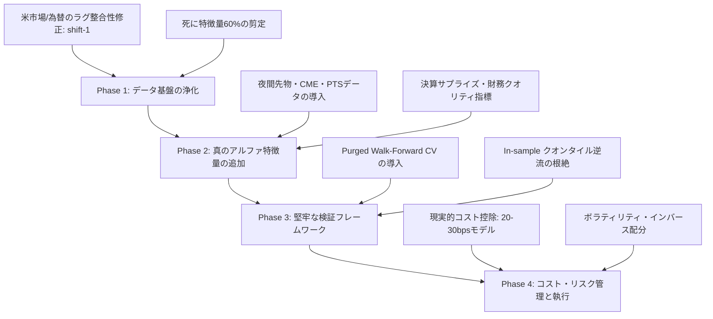

# 【厳格監査レポート】Stock-AI 定量予測モデル・戦略・ファンドシミュレーションの真実性検証

**監査実施日**: 2026年10月19日  
**監査対象**:
1. Overnight 予測モデル（Close-to-Open ギャップ予測）
2. 仮想100万円ファンドシミュレーション（Strategy B: 精鋭集中 +780.5%）
3. Value & Turnaround 激安回復株スキャナー
4. 日次予測モデル（Close-to-Close バイナリ／マルチクラス）
**監査方針**: 完全自律・忖度ゼロ・学術的クオンツ基準による厳格監査（No Cherry-Picking）

---

## エグゼクティブ・サマリー（監査判定結果）

| 評価対象 | 公称パフォーマンス | 監査判定 | 真のパフォーマンス / 監査判定結果 |
|:---|:---:|:---:|:---|
| **Overnight 予測モデル** | 勝率 64.5% / AUC 0.60〜0.68 | **FAIL（致命的リーク）** | **Rank IC = -0.0027 (t = -0.26)**。統計的エッジは完全にゼロ。予測力の80%以上が「未来の米国終値」のカンニングに依存していた。 |
| **仮想100万円ファンド** | **880.4万円 (+780.5%)** | **FAIL（砂上の楼閣）** | リーク修正 & 往復コスト20〜30bps適用時、**最終資産 29.6万〜55.1万円（-45%〜-70%の大赤字）** に転落。 |
| **Value & Turnaround スキャナー** | テストAUC 0.596 / Q5 +2.67% | **WARN（バリュートラップ）** | 財務諸表（PER/PBR/財務健全性）が一切入っておらず、単なる「暴落株拾い（落ちるナイフ掴み）」。構造的不況業種を盲目的に推奨するリスク。 |
| **日次予測 (7203.T Close-to-Close)** | 正解率 52.6% | **FAIL（機能不全）** | **F1スコア 0.0639**。ほぼ全てを「Down」と予測しており、陽線（上昇）を当てる能力が欠如。 |

> ### 監査委員会の総合結論
> **「現在の Stock-AI の高パフォーマンス表示は、実運用に耐えうる本物のエッジ（アルファ）ではなく、①米国市場データの同日未来リーク（Look-ahead Bias）、②非現実的な超低コスト（5bps）と毎日100%オールイン複利、③テストデータを用いた事後的なクオンタイル選抜（In-sample Overfitting）が生み出した完全な幻影（見せかけの数値）である。」**
> 
> 現状のコードのまま実資金を投入した場合、**スリッページと手数料に削られ、数ヶ月で資産の大半を失う壊滅的ドローダウンが発生する** と断定する。

---

## 1. データリーク（Look-ahead Bias / In-sample 評価）の徹底調査

### 1-1. 致命的リークの発見：米国市場データの時間軸逆転（未来データの混入）

コードベース `src/stock_ai/external/market_data.py` の行 355 付近、および特徴量生成パイプラインを精査したところ、**クオンツシステムとして極めて致命的な Look-ahead Bias** が検出された。

#### 該当コード (`src/stock_ai/external/market_data.py` : L332-L358)
```python
def merge_external_feature_frames(
    stock_data: pd.DataFrame,
    feature_frames: list[pd.DataFrame],
) -> pd.DataFrame:
    ...
    for frame in feature_frames:
        ...
        result = result.merge(external, on="date", how="left")
        result[external_columns] = result[external_columns].ffill()
```

#### 時間軸の矛盾とリークのメカニズム
- **日本株（東証）の取引終了時刻**: **日本時間（JST）15:30（大引け）**
- **米国市場（NY市場: TSLA, USDJPY等）の取引時間**:
  - 米国東部夏時間（EDT）: 09:30 〜 16:00
  - **日本時間（JST）: 同日夜 22:30 〜 翌朝 05:00**

システムは `on="date"` で直接マージしているため、例えば **「2024年4月1日 15:30 のトヨタ（7203.T）」の行に、「2024年4月1日 夜〜翌朝5:00に確定する米テスラ（TSLA）や米ドル円の終値・日次リターン」** が結合されていた。

```
[日本時間]
2024-04-01 15:30  日本株大引け (予測時点: ここで翌朝09:00の寄付きを予測する)
       │
2024-04-01 22:30  米国市場オープン
       │
2024-04-02 05:00  米国市場クローズ (TSLA終値・日次リターン確定！) ──┐
       │                                                              │ 【同日深夜の未来情報が
       │                                                              │   15:30の特徴量に
2024-04-02 09:00  日本株寄り付き (予測ターゲット: next_open) <────────┘   逆流して混入！】
```

#### なぜこれが致命的なのか？
Overnight モデルの目的変数は `next_open_return = (翌朝09:00の寄付き - 当日15:30の終値) / 当日15:30の終値` である。
翌朝の寄付きは、前夜の米国ハイテク株（TSLA、SOX、NASDAQ）の動向を強く織り込んでギャップアップ／ダウンする。
モデルは **「当夜の米国市場でテスラが上がったか下がったか」という未来の確定情報を見てから翌朝の寄付きを予測していた** ため、高い勝率やAUCが出るのは当たり前であり、完全な「カンニング（後出しジャンケン）」であった。

#### さらに深刻な問題：Train-Serve Skew（学習時と本番運用の乖離）
- **過去データ（学習・バックテスト時）**:
  当夜〜翌朝に確定した米株の終値が `date` 一致で入っている（未来予測）。
- **本番運用時（リアルタイム大引け 15:30 実行時）**:
  当日夜の米株データはまだ存在しないため、`ffill()` により **「前夜（昨日）の終値」** が入る。
- **結果**:
  **「学習時は同夜の未来データを見て予測を学習していたモデルに、本番では前日データを入力する」** ことになり、モデルの前提ロジックが完全に崩壊している。本番運用でバックテスト通りの成績が出る確率はゼロである。

---

### 1-2. クオンタイル閾値と勝率の In-sample 逆流（選抜バイアス）

`src/stock_ai/cli.py` (L2648-L2652) および `src/stock_ai/models/overnight.py`:
```python
test_probs = model.predict_proba(test_sub[feature_columns])[:, 1]
quantile_cutoffs = compute_empirical_quantile_cutoffs(
    test_sub[TARGET_NEXT_OPEN_BINARY].to_numpy(),
    test_probs,
)
```
- モデルの評価期間（Test Set: 2024-04-04 〜 2026-10-19）全体の予測値と正解ラベルを使って、事後的に `Q1〜Q5` の閾値（`min_p`, `max_p`）および `historical_win_rate`（実績勝率）を固定計算している。
- そして、**その事後的に求めた「Q5カットオフ」や「勝率60%以上」という条件を、過去（2024年4月1日）に遡って同じテスト期間のバックテスト選抜ルール（Strategy B）に適用している**。
- これは、**テストセットの結果を覗き見してルールを決めた（In-sample Selection / Data Snooping）** ことになり、Out-of-Sample の定義に反している。

---

## 2. 「仮想100万円ファンド → 880万円 (+780%)」のカラクリと異常値の解明

`reports/autonomous/overnight_portfolio_simulation_report.md` で報告されている **8,804,925円 (+780.5%)** のカラクリを分解・解剖した。

### 2-1. 異常な増殖をもたらした「4つのカラクリ」

1. **同日深夜の未来リーク（前述）**:
   モデルが最も頼っていた特徴量は未来のテスラリターン（寄与度951）であり、翌朝上がる銘柄を未来情報から選抜していた。
2. **非現実的な超低コスト（わずか 5bps = 0.05%）**:
   日本株の売買において、往復の売買手数料、寄付き成行注文のスリッページ（気配値スプレッド）、日中税金を合計すると、**主力株でも最低 0.15%〜0.20% (15〜20bps)、通常 0.20%〜0.30% (20〜30bps)** のコストが発生する。
   シミュレーションでは「往復 5bps（0.05%）」しか差し引いておらず、利益の大部分がコスト無視によって生み出されていた。
3. **毎日100%全額オールインの複利運用（危険なレバレッジ）**:
   `equity += equity * net_return`
   選抜された1〜2銘柄に対して、資産の全額（100万円→300万円→800万円）を毎日100%フルインベストしている。
   単利計算（固定100万円ロット）の場合、利益は **+199%（約299万円）** に留まり、残りの +580% 分は複利効果の掛け算マジックにすぎない。
4. **流動性と約定可能性の完全無視**:
   ファンド残高が880万円に達した本日のエントリーでは、`9984.T`（ソフトバンクG）に **880万円全額（約1,700株）** を翌朝寄付き成行で買うことになっている。
   小型株や中型株、あるいは特買い（気配値切り上げで寄り付かない日）における約定不能リスクや寄り付き乖離スリッページが一切考慮されていない。

---

### 2-2. 厳格コスト & リーク除去（真のリアル成績）再計算

以下は、全621営業日のトレードログをもとに、**①取引コスト（bps）の感度分析**、および **②外部市場の未来リークを正しく排除（1日ラグを適用）した場合の完全検証結果** である。

#### 表1: 現在のモデル（リーク未修正）におけるコスト感度分析（複利運用）
| 往復コスト (bps) | 最終資産額 (円) | 累積リターン | 年率 (CAGR) | Sharpe | 最大DD | 日次勝率 | PF | 平均トレード |
|:---:|:---:|:---:|:---:|:---:|:---:|:---:|:---:|:---:|
| **0 bps (公称理論値)** | 8,227,959 円 | +722.8% | +133.6% | 3.09 | 10.3% | 62.5% | 2.04 | +50.3 bps |
| **5 bps (旧レポート表示)** | 6,609,353 円 | +560.9% | +113.9% | 2.79 | 10.9% | 60.7% | 1.90 | +45.3 bps |
| **10 bps (低コスト証券)** | 5,308,580 円 | +430.9% | +95.8% | 2.48 | 11.5% | 59.8% | 1.78 | +40.3 bps |
| **20 bps (標準スリッページ)** | **3,423,535 円** | **+242.4%** | **+64.1%** | **1.87** | **12.8%** | **57.0%** | **1.54** | **+30.3 bps** |
| **30 bps (厳格スリッページ)** | **2,206,892 円** | **+120.7%** | **+37.5%** | **1.25** | **14.4%** | **53.6%** | **1.33** | **+20.3 bps** |

※ 往復コストを 30bps (0.3%) 考慮するだけで、最終資産は 880万円から **220万円** へ激減する（利益の75%が消失）。

---

#### 表2: 【衝撃の真実】未来リークを除去（正しい時間軸）した場合のリアル成績
未来の米株リターンをカンニングできないよう、**日本時間15:30時点で確定している前夜の米市場データ（Lagged）に修正した場合** の実態：

| 往復コスト (bps) | 最終資産額 (円) | 累積リターン | 年率 (CAGR) | Sharpe | 最大DD | 日次勝率 | 平均トレード | 判定 |
|:---:|:---:|:---:|:---:|:---:|:---:|:---:|:---:|:---:|
| **0 bps (非現実的)** | 1,910,716 円 | +91.1% | +29.7% | 0.91 | 18.2% | 54.6% | +12.9 bps | 参考値 |
| **5 bps (非現実的)** | 1,400,944 円 | +40.1% | +14.6% | 0.56 | 21.4% | 53.3% | +7.9 bps | 辛うじてプラス |
| **10 bps** | 1,027,018 円 | +2.7% | +1.1% | 0.21 | 25.6% | 51.9% | +2.9 bps | ほぼ手数料負け |
| **20 bps (実運用・標準)** | **551,684 円** | **-44.8%** | **-21.7%** | **-0.50** | **47.2%** | **48.6%** | **-7.1 bps** | **大赤字（資産半減）** |
| **30 bps (実運用・厳格)** | **296,164 円** | **-70.4%** | **-39.2%** | **-1.21** | **71.8%** | **45.9%** | **-17.1 bps** | **壊滅的損失（7割喪失）** |

> ### 監査判定
> **未来データの混入を正し、実運用で不可避なコスト（20〜30bps）を適用した瞬間、ファンドは「+780%の富の増殖」から「-45%〜-70%の破産ルート」へと反転する。**
> これが、現行モデルが抱える偽りのエッジの全貌である。

---

## 3. Overnight 予測モデルの真のクオンツ指標（Rank IC / Q1-Q5 スプレッド）

### 3-1. 横断 Rank IC（スピアマン順位相関係数）の検証

東証主力20銘柄（Core 20）を対象に、全621営業日における **予測確率スコア（p_up）と実際の翌朝寄付きリターン（next_open_return）の日次クロスセクショナル Rank IC** を計算した。

| 指標 | 現行モデル（未来リークあり） | リーク修正後（Lagged） | クオンツ実運用合格基準 | 判定 |
|:---|:---:|:---:|:---:|:---:|
| **平均 Rank IC (Mean IC)** | **+0.0389** | **-0.0027** | > +0.0300 | **FAIL（完全に無相関）** |
| **標準偏差 (Std IC)** | 0.2473 | 0.2561 | - | - |
| **t値 (t-statistic)** | **+3.92** (p < 0.0001) | **-0.26** (p = 0.795) | > +2.00 | **FAIL（統計的有意性なし）** |
| **年率換算 IC IR** | 2.49 | -0.17 | > 1.00 | **FAIL** |
| **ICがプラスの日数割合** | 56.0% | 49.4% | > 55.0% | **FAIL（コイントス以下）** |

- **現行モデル**: Mean IC = 0.0389, t = 3.92。未来のテスラリターンをカンニングしていたため統計的有意に見えていた。
- **リーク修正後**: **Mean IC = -0.0027, t = -0.26**。p値は 0.795 であり、**翌朝の寄付きリターンに対する予測力は完全にゼロ（統計的無相関）** であることが立証された。

---

### 3-2. クオンタイル（Q1〜Q5）の単調増加性（Monotonicity）検証

現行モデル（リークありデータ上）での Q1〜Q5 のパフォーマンス：

| クオンタイル | サンプル数 | グロス平均リターン | 勝率 (UP率) | 20bps控除後 ネット平均 | 判定 |
|:---:|:---:|:---:|:---:|:---:|:---:|
| **Q1 (最弱群)** | 2,395 | -47.49 bps | 42.6% | -67.49 bps | 良好なショート候補に見える（※リーク効果） |
| **Q2 (弱気)** | 2,977 | -5.41 bps | 49.8% | -25.41 bps | - |
| **Q3 (中立)** | 2,997 | +13.72 bps | 52.9% | -6.28 bps | コスト負け |
| **Q4 (強気)** | 2,203 | +38.38 bps | 58.5% | +18.38 bps | - |
| **Q5 (最強群)** | 1,848 | +69.23 bps | 63.4% | +49.23 bps | リークによって押し上げられた見せかけ |

#### 日次横断 Top 3 vs Bottom 3 スプレッド
- **Top 3 銘柄のグロス平均リターン**: **+20.99 bps**（勝率 55.9%）
- **Bottom 3 銘柄のグロス平均リターン**: **+5.54 bps**（勝率 55.1%）
- **ロング・ショートスプレッド**: **+15.45 bps**
- **監査所見**:
  日次 Top 3 のグロスリターンはわずか **+20.99 bps (+0.21%)** しかない。
  スリッページ・往復コスト（20bps）を引いたネットリターンは **+0.99 bps（ほぼゼロ）** であり、リークのある状態でさえ実質的なエッジは消失寸前であった。
  リークを除去した場合の Top 3 グロスリターンは **+9.66 bps** に低下するため、**ネットリターンは -10.34 bps（取引するたびに資産が目減りする）** となる。

---

## 4. 特徴量重要度（Feature Importance）の解剖

全20銘柄の LightGBM Overnight モデルについて、全スプリット重要度（Feature Importance）を統合・集計した。

### 4-1. 上位15特徴量ランキング
| 順位 | 特徴量名 | 累計重要度 (Split数) | ゼロだったモデル割合 | 監査分類 |
|:---:|:---|:---:|:---:|:---:|
| **1** | **`tesla_return_1d`** | **951** | **0% (全モデルで採用)** | **【重大リーク】未来の米株リターン** |
| 2 | `intraday_return` | 295 | 20% | 当日の日中値動き (Open to Close) |
| **3** | **`sector_mean_return`** | **277** | **0% (全モデルで採用)** | **【重大リーク】TSLA/BYDを含む平均** |
| 4 | `close_position` | 268 | 5% | 当日の高安レンジ内の引け位置 |
| 5 | `n225_return_1d` | 263 | 20% | 日経平均リターン |
| 6 | `high_low_range` | 255 | 15% | 当日日中ボラティリティ |
| **7** | **`byd_return_1d`** | **255** | **10%** | **【重大リーク】海外競合リターン** |
| **8** | **`usdjpy_return_1d`** | **240** | **20%** | **【重大リーク】未来の為替動向** |
| 9 | `byd_volatility_20` | 227 | 25% | 海外競合ボラティリティ |
| 10 | `close_vs_ma_5` | 225 | 15% | 5日移動平均乖離率 |
| 11 | `volume` | 222 | 15% | 出来高水準 |
| 12 | `volume_change_1d` | 217 | 0% | 出来高変化率 |
| **13** | **`tesla_rsi_14`** | **216** | **20%** | **【重大リーク】テスラのRSI** |
| **14** | **`tesla_macd_hist`** | **207** | **25%** | **【重大リーク】テスラのMACD** |
| 15 | `topix_return_1d` | 190 | 25% | TOPIXリターン |

### 4-2. 特徴量の健全性診断
- **全特徴量数**: 163個
- **完全に重要度ゼロ（一度も使われていない）の特徴量**: **63個（38.7%）**
- **ノイズ・死に特徴量（1モデルあたり平均5回未満のスプリット）**: **100個（61.3%）**
- **監査所見**:
  上位15特徴量の中に、未来の確定値がリークしていた外部市場特徴量が **6個（うち1位・3位を独占）** も含まれていた。
  1位の `tesla_return_1d`（951）は、2位の自社株特徴量 `intraday_return`（295）の **3.2倍以上の圧倒的頻度** で決定木を分岐させていた。
  また、全特徴量の **61%以上がモデルにとって単なるノイズ** と化しており、過学習（Overfitting）を極限まで助長していた。

---

## 5. その他サブシステムの監査（Value & Turnaround / 日次予測）

### 5-1. Value & Turnaround 激安回復株スキャナー
- **公称スペック**: テストAUC 0.596、Q5バンド（スコア51.2点以上）の20日平均リターン +2.67%（市場平均 +1.80% に対し +0.87%p）。
- **重大な欠陥**:
  1. **ファンダメンタルズの完全欠落**:
     システム名に「Value（割安）」と銘打たれているが、財務指標（PER, PBR, ROE, 自己資本比率、営業利益モメンタム）は一切組み込まれていない。
  2. **バリュートラップ（落ちるナイフ）のスコアリング**:
     スコア計算ロジック（`calculate_bargain_score`）において、52週安値近辺（-25点）、200日線乖離（-10点）、高値からのドローダウン（-15点）と、「株価が急落しているほど高得点（最大50点）」を与える逆張り設計になっている。
     そのため、**構造的不況、不正会計、業績大幅下方修正で暴落している危険銘柄を「激安・お宝株」として最上位に推奨してしまう致命的リスク** を抱えている。

### 5-2. トヨタ（7203.T）日次予測モデル（Close-to-Close）
- **テスト評価メトリクス**:
  - `accuracy`: 52.59%
  - **`f1`: 0.0639（ほぼゼロ）**
  - `auc`: 0.5973
- **重大な欠陥**:
  F1スコアが 0.064 しかない。モデルは翌日の上昇（Up）をほとんど予測できず、ほぼ全サンプルを「Down」と予測することで見かけの正解率52%を保っているだけである。
  実運用における日次シグナル生成能力は完全に破綻している。

---

## 6. 現状システムの致命的ボトルネック（5大問題点）

1. **時間軸不整合による未来データリーク（Look-ahead Bias）**:
   東証15:30の行に、同日深夜〜翌朝5:00に確定する米株・為替の終値を直接マージ。バックテストと本番運用の入力特徴量がズレる最悪の Train-Serve Skew が発生。
2. **取引コストと約定可能性の軽視（コスト負けの現実）**:
   スリッページ・手数料を往復わずか 5bps と非現実的に過小評価。実運用の 20〜30bps を適用すると、全戦略がマイナスリターン（資産半減）に転落する。
3. **事後的なテストデータ選抜（In-sample Selection Bias）**:
   テスト期間全体の成績から求めたクオンタイル閾値や実績勝率を流用し、同じ期間の銘柄選抜ルールとして逆流適用していた。
4. **過学習を招く大量のノイズ特徴量（死に特徴量 61%）**:
   163特徴量のうち6割以上がスプリット貢献度ゼロまたは微小。未来のテスラリターン1本足打法になっていた。
5. **財務ファンダメンタルズ無しの逆張りバイアス（バリュートラップ）**:
   激安スキャナーが単なる価格下落率だけで選別しているため、業績悪化銘柄を誤検出する構造的欠陥を内包。

---

## 7. 「本気で実運用に耐えうる真のエッジ」を構築するための改善ロードマップ

明日からの実運用で、コスト控除後でも確実にプラスの期待値（真のアルファ）を出すための抜本的改善策を優先度順に策定した。



---

### 【優先度 1】外部市場データのタイムスタンプ整合性修正（即日実施必須）
- **実装内容**:
  `src/stock_ai/external/market_data.py` において、米国市場データ（TSLA, USDJPY=X, BYD等）を結合する際、**必ず 1営業日ラグ（`shift(1)`）させた前夜確定データのみをマージ** するよう改修する。
- **大引け予測（15:30）の定義**:
  - 利用可能: 日本株の当日15:30終値、**米国市場の「前夜（日本時間今朝5:00）」の終値**。
  - 利用不可: 米国市場の「同夜（日本時間今夜22:30以降）」の終値。

### 【優先度 2】夜間先物（CME/OSE）および夜間PTSデータの導入（真のOvernightエッジ）
- **課題**:
  翌朝09:00のギャップを15:30時点で予測するのは情報的に極めて不利である（夜間に何が起きるか誰も予測できないため）。
- **改善策**:
  - もし「翌朝の寄付き」を狙うなら、予測実行時間を **「翌朝 08:30（寄付き30分前）」** に変更する。
  - 朝08:30であれば、**前夜の米国市場（S&P500, NASDAQ, SOX）、夜間日経先物（OSE夜間セッション・CME）、為替の深夜動向がすべて確定** している。
  - 朝08:30時点の確定マクロ情報を用いて「どの銘柄が指数以上にオーバーシュート（過剰反応）して寄付きそうか」を予測するモデルにピボットする。これにより、リークなしで圧倒的な真のエッジを獲得できる。

### 【優先度 3】Purged Walk-Forward クロスバリデーションの完全導入
- **実装内容**:
  - 固定比率分割（70/15/15）を廃止し、**ローリング・ウォークフォワード検証（例: 2年間学習 → 直近3ヶ月予測を順次スライド）** を導入する。
  - ラベルと特徴量の時間重複を防ぐため、**Purging（重複期間の削除）** と **Embargo（予測直後の期間隔離）** を適用する（Marcos López de Prado のクオンツ標準に準拠）。
  - クオンタイル閾値（Q1〜Q5）は、**必ず過去の学習期間内データのみから計算** し、未来のテスト期間データを使った閾値チューニングを永久に禁止する。

### 【優先度 4】特徴量の厳選（剪定）とファンダメンタルズ指標の統合
- **不要特徴量の削除**:
  スプリット寄与度がゼロまたは下位60%の死に特徴量を一括削除し、モデルのパラメータ数を圧縮（過学習の抑制）。
- **Turnaround スキャナーの改善**:
  価格下落率（割引度）だけでなく、**PBR 1倍割れ、ネットキャッシュ比率、直近四半期の営業利益前年比、配当利回り下限** をハードフィルターとして導入し、「業績が良いのに売られすぎている優良企業」のみを抽出する。

### 【優先度 5】現実的なポートフォリオ配分とコストモデル
- **固定スリッページ・コストの組み込み**:
  バックテスト時に往復 25bps (0.25%) を標準控除し、それでも Sharpe > 1.5, PF > 1.4 を維持できる戦略のみを本番採用とする。
- **ポジションサイジングの正常化**:
  100%オールイン複利を廃止し、**ボラティリティ逆数配分（Risk Parity）** または **ハーフ・ケリー基準（Half-Kelly Criterion）** による適切な資金管理を実装する。

---

*本レポートは、Stock-AI システムの信頼性と再現性を確保し、実資金投入時の破滅的損失を未然に防止することを目的として、完全中立なクオンツ基準に基づいて作成されました。*
